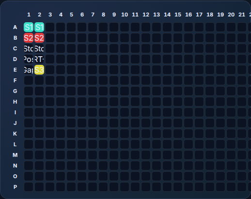
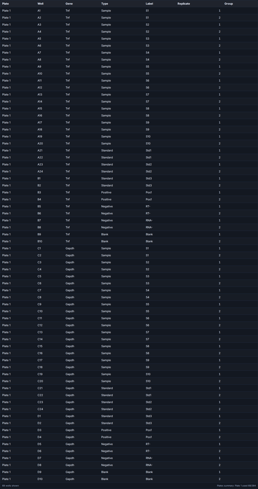

# qPCR Planner (EasyLab Next branch)

This isolated Next module contains the React + FastAPI qPCR Planner. It includes editable SYBR/TaqMan recipes, 96- and 384-well layouts, recipe and transfer checks, a per-sample template-volume budget, local versioned experiment packages, and a CSV handoff for qPCR Analysis. The sample list starts empty; no placeholder sample names are inserted.

## Next local development

From this module root, `npm run dev` starts the guarded Next launcher. It uses the isolated Planner Python environment and binds only to `127.0.0.1:19512` (UI) and `127.0.0.1:18512` (API). The launcher checks the Planner API identity before showing the UI.

In qPCR Analysis, load the Planner handoff CSV as sample information and choose **Plate and Well** to match the instrument file. The exported Cq cells are intentionally blank; Analysis fills them from the instrument data. Review the sample IDs, recipe and layout in Planner before copying or exporting a final handoff.

Phase 3 design and QA record: [qPCR Planner review](design-review/next-calculators-phase-3/README.md).

The master-mix table lists every recipe component from the calculation service, with separate per-reaction and preparation totals. After the same review, copy the mix as TSV or export it as CSV; pooled components include overage and individual well transfers do not.

Part of **EasyLab Suite**: the isolated Next desktop route launches this module as **qPCR Planner**. License: All Rights Reserved.

## Historical interface reference

The screenshots below belong to the original interface, not the current EasyLab Next Planner. They are retained as historical references (80-sample multi-plate run, Plate 2 selected in preview).

| App overview | Plate preview | Output table | Master mix |
| --- | --- | --- | --- |
|  |  |  |  |

- Full gallery + setup/run/test docs: `modern-app/README.md`
- Legacy/other scripts: see `LEGACY.md`.

## Historical original installer notes

The instructions below describe the pre-Next Windows desktop app. They do not launch or install the current Next Planner.

### Original desktop installer (Windows, historical)
From the repo root (next to this README):

```bash
npm install
npm run build:electron
```

The installer is generated in `desktop/dist/` as an `.exe` (NSIS). In that original app, first run asks for storage folders and creates them.

Notes:
- The packaged app expects Python 3.10+ available on PATH to run the FastAPI backend. You can set `APP_PYTHON_PATH` to a specific Python executable if needed.
- The installer is unsigned unless code-signing credentials are configured.
