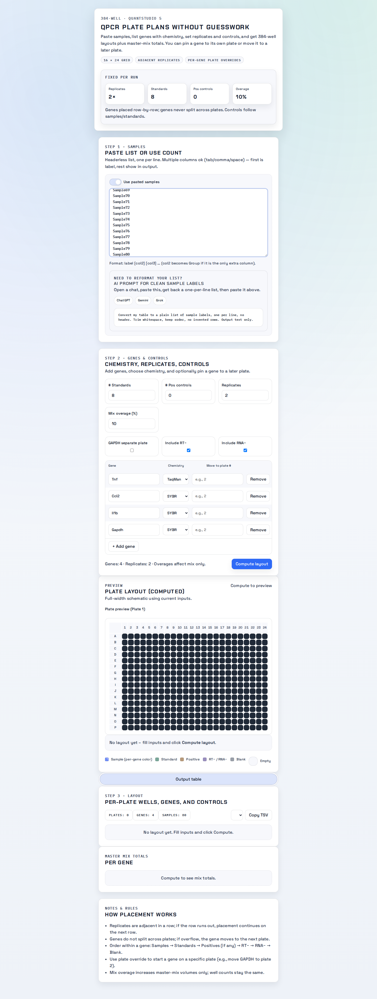
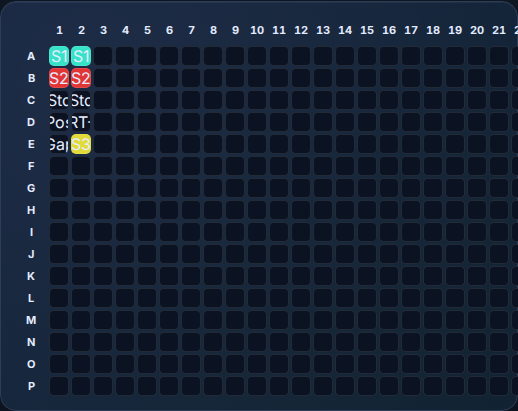
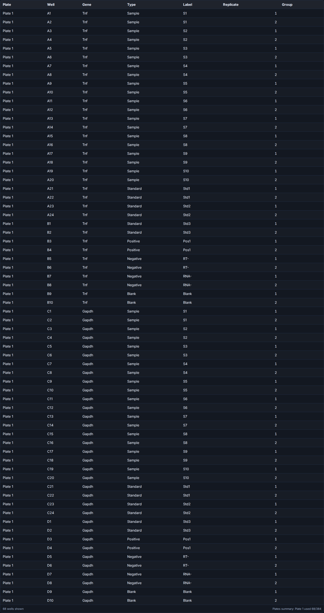
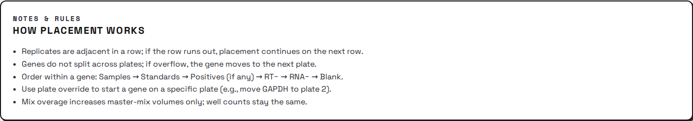

# qPCR Planner (EasyLab Next branch)

## Current Next development route

From the module root, run `npm run dev`. The guarded launcher uses the isolated Next Planner Python environment and binds the UI to `127.0.0.1:19512` and the API to `127.0.0.1:18512`; it verifies that the API identifies itself as the Next qPCR Planner before Vite starts.

The Planner supports editable SYBR/TaqMan recipes, sample mass or volume input, kit-sourced limits, pipetting preferences, working dilutions, 96- and 384-well layouts, and versioned local experiment packages. A final TSV or qPCR Analysis handoff requires a current computed layout, no recipe/transfer issues, and an explicit review of sample IDs, recipe and layout. The master-mix table and its TSV/CSV exports use every calculated recipe component and identify whether preparation overage is included.

Phase 3 design and QA record: [qPCR Planner review](../design-review/next-calculators-phase-3/README.md).

Sample input starts empty. The Planner does not insert placeholder samples into a new plan.

In the browser build, saved packages and presets stay in the browser profile’s local storage, and exported files go to the browser’s configured download location. The browser build does not require folder setup.

For qPCR Analysis, load the handoff CSV as sample information and match instrument wells by **Plate and Well**. The Cq column is intentionally blank for Analysis to fill from the instrument file.

Run the isolated checks with `npm run build`, `npm run lint`, and `npm --prefix modern-app run test:e2e`. Python planner tests use the Next `qpcr-planner` environment.

## Historical interface reference (original build)

Paste samples, pick genes/chemistry/replicates, add controls/overage, and get multi-plate 384-well layouts plus master-mix totals. Styling matches the lab notebook neo-brutalist system. Screenshots below come from a Playwright run (Dec 28, 2025) using 80 samples to force multiple plates; Plate 2 is selected in the preview.

Part of **Easylab Suite**: this repo is bundled as the **qPCR Planner** module (`qpcr-planner`).
License: All Rights Reserved.

Historical screenshots (80 samples, multi-plate):

| Plan view | Plate preview | Output table | Master mix | Notes |
| --- | --- | --- | --- | --- |
|  |  |  |  |  |

Run-through video:

<video src="screenshots/example_run.webm" controls width="820"></video>

Extra captures (full-page + closeups): `screenshots/example_run.png`, `screenshots/layout_full.png`, `screenshots/plan_view.png`, `screenshots/plate_preview.png`.

## Highlights
- 384-well 16×24 grid; replicates stay adjacent in-row.
- Pack genes onto as few plates as possible *within a chemistry* (SYBR and TaqMan are kept on separate plates). Optional per-gene plate overrides.
- Controls: standards, positives, RT−, RNA−, blanks; adjustable mix overage for master-mix only.
- Outputs: interactive table, TSV copy, CSV/Excel export hooks, per-gene master-mix volumes.
- Paste samples with multiple columns (tab/comma/space). First token is the label; all remaining columns render in the output table.

### Primer solutions

Choose **Working (10 µM)** or **Stock (100 µM)** under Genes & controls, then compute the layout. This setting applies to both forward and reverse primers for every gene. The existing primer dose is preserved: each reaction uses 0.30 µL per primer from a working solution or 0.03 µL per primer from stock. Water fills the difference so the reaction volume stays the same. TaqMan probes retain their separate 10 µM recipe.

The master-mix results show the primer concentration used in that calculation. Changing the selector requires computing again. API requests use `primer_source` (`working` by default or `stock`); mix rows return `primer_concentration_uM`, `fwd_primer_ul`, and `rev_primer_ul` instead of the old concentration-specific primer volume keys.

### Historical original module setup and installer notes

The following instructions describe the original module, not the guarded Next launcher above. They do not launch or install the EasyLab Next Planner.

#### Original desktop installer (Windows, historical)
From the repo root (one level above `modern-app`):

```bash
npm install
npm run build:electron
```

The installer is generated in `desktop/dist/` as an `.exe` (NSIS). On first run, the app asks for storage folders and creates them for you.

Notes:
- The packaged app expects Python 3.10+ available on PATH to run the FastAPI backend. You can set `APP_PYTHON_PATH` to a specific Python executable if needed.
- The installer is unsigned unless code-signing credentials are configured.

## Data format & quick AI helper
- Simplest input: two-column CSV/TSV with headers `Sample, Conc` (ng/µL). The app also accepts wider tables; the first token per row becomes the label.
- To standardize quickly, use: [ChatGPT](https://chat.openai.com/), [Gemini](https://gemini.google.com/app), [Grok](https://grok.com/).
- Prompt: "Convert my table to CSV with headers: Sample, Conc. Keep values intact, no invented data, output UTF-8 CSV text only."
- Save as `samples.csv` and paste or upload. Visual helper: `screenshots/data-format-helper.svg`.

#### Original tests & screenshots
```bash
npx playwright install chromium   # once
npm run test:e2e                  # basic smoke
```
To regenerate the gallery with mocked `/plan`, start `npm run preview -- --host --port 5176` and run the Playwright snippet from the dev notes (routes `/plan` and saves into `screenshots/`).

## API
- `POST /plan` → layout[], mix[], summary[] (body includes samples, genes, controls, overage, overrides)
- `GET /health`
